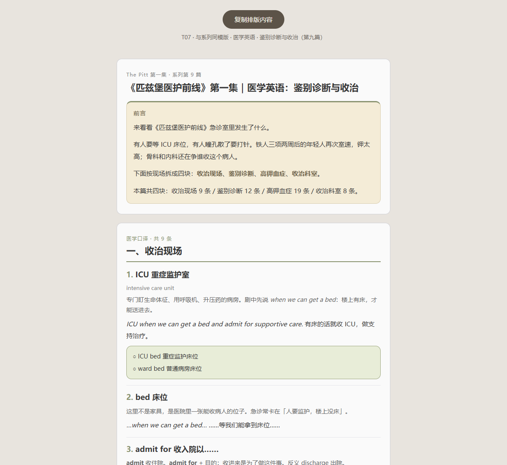

# From Dialogue Notes to WeChat Articles

An Agent Skill that turns English dialogue, expressions, and questions you note while watching a series into explanations and WeChat Official Account articles. The Pitt is the real case study featured here.

**[Open the full web demo →](https://clairelind1.github.io/series-content-skill/skills/series-content-skill/showcase.html)** · [Skill instructions](skills/series-content-skill/SKILL.en.md) · [中文介绍](README.md)

## What it can do

- **Explain your notes:** Clarify the lines, expressions, or questions you selected, adding context, terminology, abbreviations, pronunciation, Chinese meaning, and examples. Unverified details are flagged.
- **Shape article content:** Organize explanations into themed series articles, or provide a glossary, outline, or editorial review.
- **Format for WeChat:** Generate Markdown and HTML with a “Copy formatted content” button, ready to paste into the WeChat article editor.

## Article preview

This image is rendered from the actual article HTML. Click it to open the full webpage and browse the layout and series examples.

## Published articles

- [Article 1 | Opening and conversational English](https://mp.weixin.qq.com/s?__biz=Mzg2ODY0MDQ0MQ==&mid=2247484003&idx=1&sn=322c6f034dba8d2993a80e43d62d8ca4&scene=21#wechat_redirect)
- [Article 9 | Differential diagnosis and admission](https://mp.weixin.qq.com/s?__biz=Mzg2ODY0MDQ0MQ==&mid=2247484137&idx=1&sn=adc7593300449d60e0ca8bd060d6fa24&scene=21#wechat_redirect)
- [Article 17 | Vomiting and accidental ingestion](https://mp.weixin.qq.com/s?__biz=Mzg2ODY0MDQ0MQ==&mid=2247484211&idx=1&sn=ace509093aa2d55a8ba42343a0923f20&scene=21#wechat_redirect)

## From article to publication

Open the article HTML and click “Copy formatted content.” In the [WeChat Official Account platform](https://mp.weixin.qq.com/), create an article, paste the body, fill in the article details, preview, and publish.

## Use

Load `skills/series-content-skill` into an AI tool that supports Agent Skills. Share the lines, expressions, or questions you noted and say whether you want a list, outline, or full article.

To preview locally, run `python -m http.server 8000` from the repository root and open `http://localhost:8000/skills/series-content-skill/showcase.html`.
