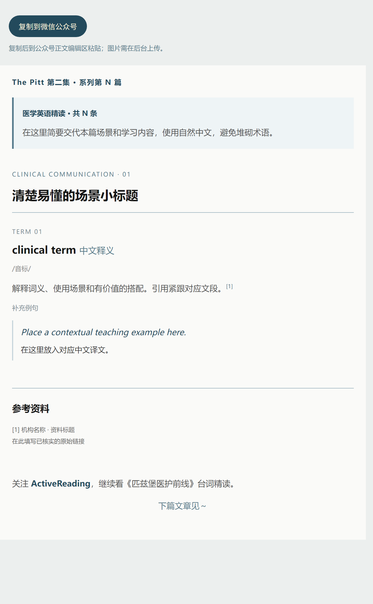
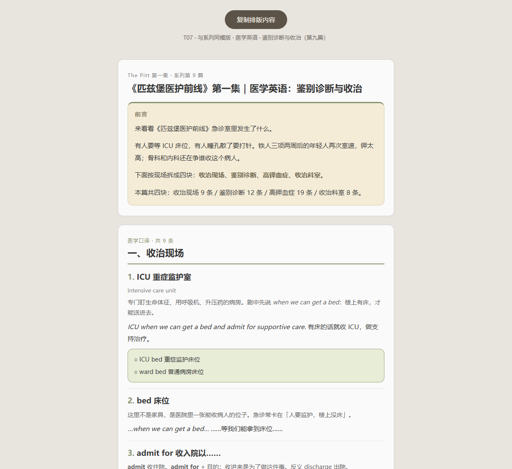
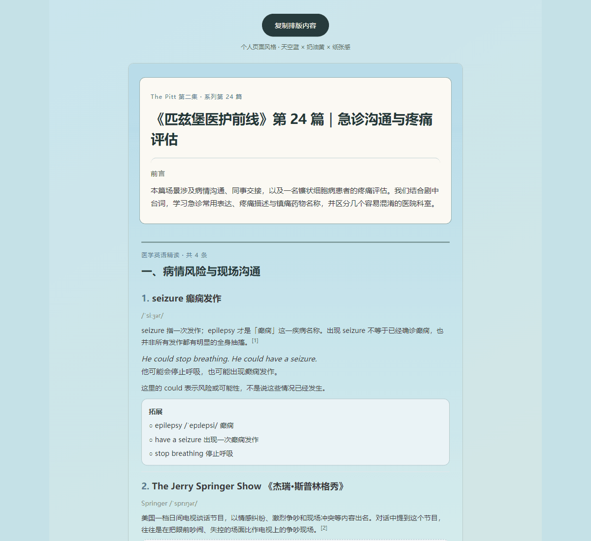

# Turn Rough Notes into Beautiful WeChat Articles

An Agent Skill that organizes rough notes into publishable WeChat articles. Structure your ideas, polish the wording, choose a layout and generate HTML you can copy into the Official Account editor. Use it for reading notes, courses, work reflections, knowledge sharing and series writing.

[Browse layouts](https://clairelind1.github.io/series-content-skill/skills/series-content-skill/showcase.html) · [中文](README.md)

## Layout previews

<table>
<tr><th width="33%">01 · Clinical Editorial 精简版</th><th width="33%">02 · 原有演示版</th><th width="33%">03 · 天空蓝 × 奶油黄</th></tr>
<tr>
<td valign="top"><a href="https://clairelind1.github.io/series-content-skill/skills/series-content-skill/templates/clinical-editorial.html"></a></td>
<td valign="top"><a href="https://clairelind1.github.io/series-content-skill/examples/the-pitt-ep1-terminology-9.html"></a></td>
<td valign="top"><a href="https://clairelind1.github.io/series-content-skill/examples/the-pitt-ep2-7-stitch.html"></a></td>
</tr><tr><td>当前默认 · 黑白蓝 · 轻分隔</td><td>柔和纸色 · 词条卡片</td><td>渐变 · 纸张感</td></tr>
</table>


**[打开交互式样式画廊 →](https://clairelind1.github.io/series-content-skill/skills/series-content-skill/showcase.html)**

桌面端切换「并排比较 / 横向浏览」，手机端左右滑动；每个样式都可滚动预览正文并打开完整 HTML。

| 样式 | 特点 | 入口 |
| --- | --- | --- |
| **01 · Clinical Editorial 精简版** | 当前默认 · 黑白蓝、留白、浅蓝例句竖线 | [预览与复制](https://clairelind1.github.io/series-content-skill/skills/series-content-skill/templates/clinical-editorial.html) |
| 02 · 原有演示版 | 柔和纸色、词条卡片 | [完整预览](https://clairelind1.github.io/series-content-skill/examples/the-pitt-ep1-terminology-9.html) |
| 03 · 天空蓝 × 奶油黄 | 渐变、纸张感 | [完整预览](https://clairelind1.github.io/series-content-skill/examples/the-pitt-ep2-7-stitch.html) |

[查看精简版模板规则](skills/series-content-skill/references/clinical-editorial.md)。新模板尚待微信公众号浅色、深色粘贴实测。


## Start with this prompt

```text
Use $series-content-skill to turn these notes into a WeChat article.
Audience: [who it is for]
Tone: [natural / professional / casual]
Layout: [choose from the previews or recommend one]
Organize and polish the content, then generate HTML with a copy button.
Preserve my viewpoint; do not invent experiences, facts or quotations.

My notes:
[paste here]
```

For an approved draft: “Keep the wording unchanged. Format it in this style and give me paste-ready WeChat HTML.”

The Pitt medical-English series is a worked example, not a restriction on subject matter. Language-learning modules are optional.

## Download and install

### Option 1: Install from the command line

Copy and run the commands for your computer in a terminal (PowerShell on Windows). They download the project and install the Skill in Codex's user-level directory.

**Windows · PowerShell**

```powershell
git clone https://github.com/ClaireLind1/series-content-skill.git
New-Item -ItemType Directory -Force "$env:USERPROFILE\.agents\skills" | Out-Null
Copy-Item -Recurse -Force ".\series-content-skill\skills\series-content-skill" "$env:USERPROFILE\.agents\skills\"
```

**macOS / Linux · Terminal**

```bash
git clone https://github.com/ClaireLind1/series-content-skill.git
mkdir -p ~/.agents/skills
cp -R series-content-skill/skills/series-content-skill ~/.agents/skills/
```

These commands install to Codex. For Claude Code or Cursor, replace `.agents` in the destination with `.claude` or `.cursor` (see the table below). Restart your Agent after installation; invoke the Skill in Codex with `$series-content-skill`.

### Option 2: Download the ZIP and install manually

1. Open the [GitHub project page](https://github.com/ClaireLind1/series-content-skill), click the green **Code** button, then choose **Download ZIP**.
2. Find the ZIP in your Downloads folder and extract it (double-click on macOS, or right-click and choose **Extract All** on Windows).
3. Open the extracted project folder and go to `skills` → `series-content-skill`. Confirm that `SKILL.md` is directly inside this folder.
4. Copy the entire `series-content-skill` folder to the user-level directory for your Agent in the table below. To make it available in only one project, use the project-level directory instead.
5. If a destination folder does not exist, create it. After copying, confirm the final path ends in `series-content-skill/SKILL.md`, then restart or reopen your Agent.

| Agent | User-level directory | Project-level directory |
|---|---|---|
| Codex | Windows: `%USERPROFILE%\.agents\skills\`<br>macOS/Linux: `~/.agents/skills/` | `<project>/.agents/skills/` |
| Claude Code | Windows: `%USERPROFILE%\.claude\skills\`<br>macOS/Linux: `~/.claude/skills/` | `<project>/.claude/skills/` |
| Cursor | Windows: `%USERPROFILE%\.cursor\skills\`<br>macOS/Linux: `~/.cursor/skills/` | `<project>/.cursor/skills/` |

**The installed folder should look like this:**

```text
skills/
└── series-content-skill/
    ├── SKILL.md
    ├── SKILL.en.md
    ├── agents/
    ├── references/
    └── templates/
```

Copy the `series-content-skill` folder inside `skills`, not the entire downloaded project folder. Do not add an extra nested folder with the same name. After restarting your Agent, invoke it in Codex by entering `$series-content-skill`. You can also mention `series-content-skill` in your request, for example: “Use it to turn these rough notes into an article and paste-ready WeChat HTML.” Ask for a glossary, outline, review, or complete article.

The Skill works from the material you provide. Keep the full repository if you also want the The Pitt case study, sample article HTML, and builder scripts.

### Preview the web demo locally

From the extracted repository root, run `python -m http.server 8000` and open `http://localhost:8000/skills/series-content-skill/showcase.html`.


