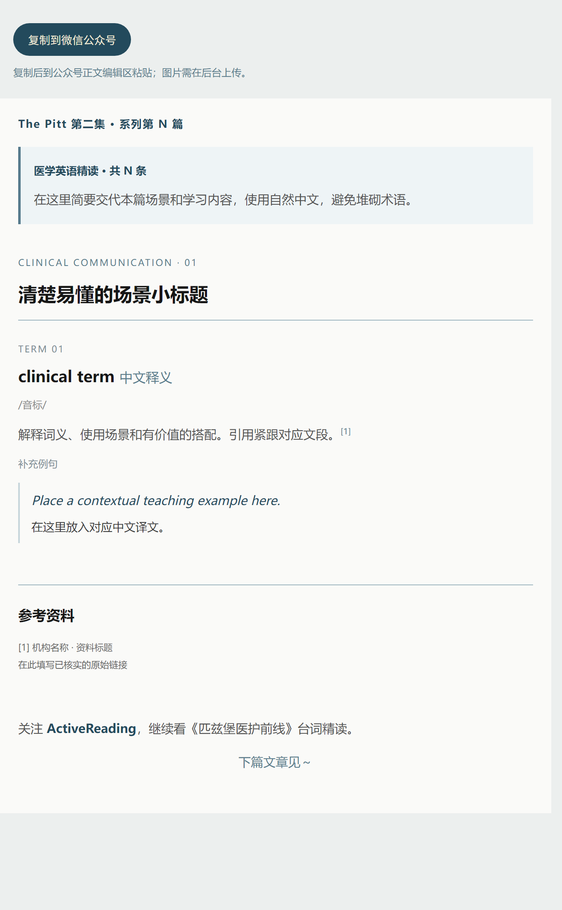
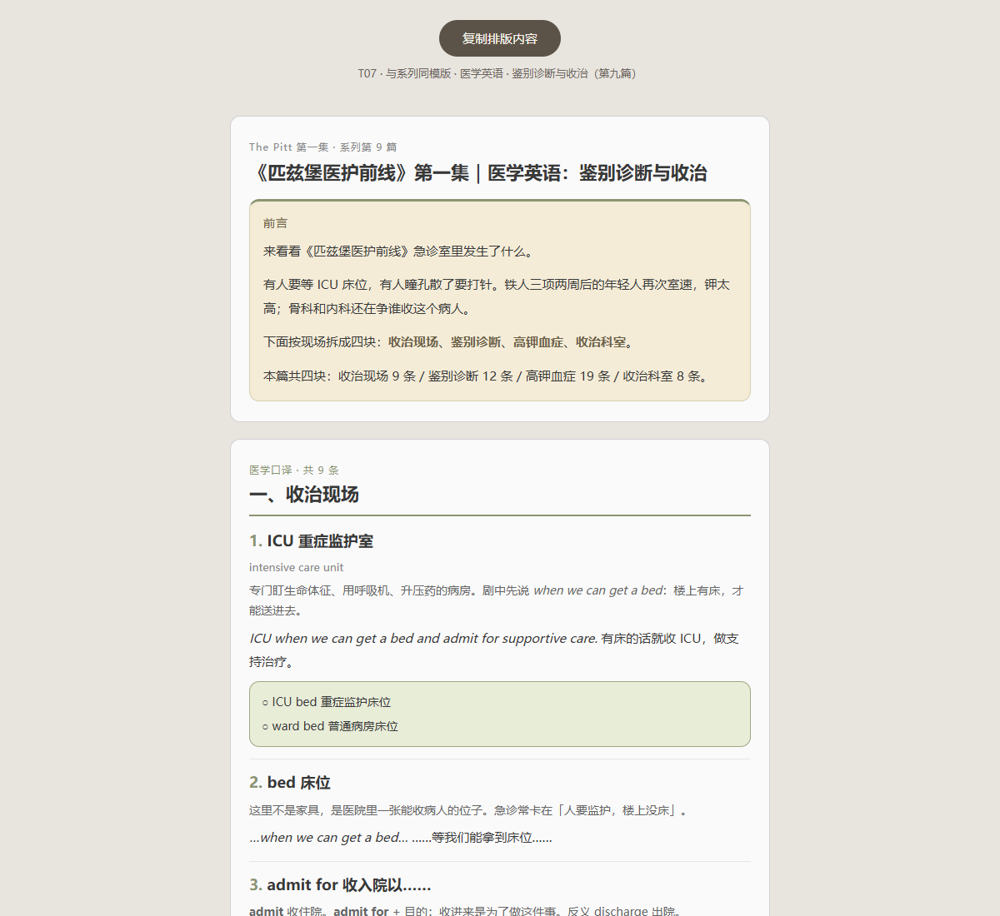
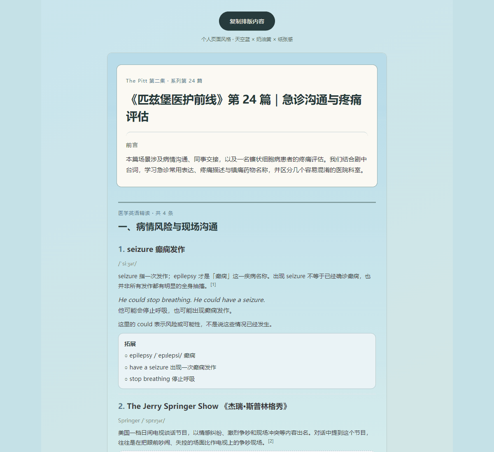

# 把零散笔记，变成好看的公众号文章

一个把零散笔记整理成微信公众号文章的 Agent Skill。支持梳理结构、润色表达、选择版式，生成可直接复制到公众号后台的 HTML。适用于读书笔记、课程记录、工作心得、知识分享和系列写作。

**记完笔记之后，写文章、改措辞、做排版，都可以从这里开始。** 多种样式可预览，选好后直接生成；满意的版式还能留给下一篇继续用。

[预览排版样式](https://clairelind1.github.io/series-content-skill/skills/series-content-skill/showcase.html) · [安装方式](#下载与安装) · [Skill 指令](skills/series-content-skill/SKILL.md) · [English](README.en.md)

## 公众号样式画廊

<table>
<tr><th width="33%">01 · Clinical Editorial 精简版</th><th width="33%">02 · 原有演示版</th><th width="33%">03 · 天空蓝 × 奶油黄</th></tr>
<tr>
<td valign="top"><a href="https://clairelind1.github.io/series-content-skill/skills/series-content-skill/templates/clinical-editorial.html"></a></td>
<td valign="top"><a href="https://clairelind1.github.io/series-content-skill/examples/the-pitt-ep1-terminology-9.html"></a></td>
<td valign="top"><a href="https://clairelind1.github.io/series-content-skill/examples/the-pitt-ep2-7-stitch.html"></a></td>
</tr><tr><td>当前默认 · 黑白蓝 · 轻分隔</td><td>柔和纸色 · 词条卡片</td><td>渐变 · 纸张感</td></tr>
</table>


**[打开交互式样式画廊 →](https://clairelind1.github.io/series-content-skill/skills/series-content-skill/showcase.html)**

桌面端切换「并排比较 / 横向浏览」，手机端左右滑动；每个样式都可滚动预览正文并打开完整 HTML。

| 样式 | 特点 | 入口 |
| --- | --- | --- |
| **01 · Clinical Editorial 精简版** | 当前默认 · 黑白蓝、留白、浅蓝例句竖线 | [预览与复制](https://clairelind1.github.io/series-content-skill/skills/series-content-skill/templates/clinical-editorial.html) |
| 02 · 原有演示版 | 柔和纸色、词条卡片 | [完整预览](https://clairelind1.github.io/series-content-skill/examples/the-pitt-ep1-terminology-9.html) |
| 03 · 天空蓝 × 奶油黄 | 渐变、纸张感 | [完整预览](https://clairelind1.github.io/series-content-skill/examples/the-pitt-ep2-7-stitch.html) |

[查看精简版模板规则](skills/series-content-skill/references/clinical-editorial.md)。新模板尚待微信公众号浅色、深色粘贴实测。


## 从笔记到成稿

| 你提供 | Skill 帮你整理 | 你拿到 |
| --- | --- | --- |
| 读书摘录、课程记录、工作心得或已有草稿 | 提炼主题、梳理结构、润色表达、匹配版式 | 可编辑文章和带复制按钮的公众号 HTML |
| 已经确认的完整正文 | 保留内容，调整层次、字号、留白和强调 | 适合公众号阅读的排版稿 |
| 系列文章和喜欢的样式 | 沿用品牌、结构和视觉规范 | 后续可继续复用的文章模板 |

不需要为了使用它把笔记改成固定格式。正文复制后，标题、封面和图片仍需在公众号后台分别填写或上传。

## 复制这条指令开始

```text
用 $series-content-skill，把下面的笔记整理成一篇微信公众号文章。
读者：[写给谁看]
语气：[自然 / 专业 / 轻松]
样式：[从预览图中选择，或让 AI 根据内容推荐]
请先梳理结构、润色表达，再生成带复制按钮的 HTML。
保留我的观点，不编造经历、事实或引用。

我的笔记：
[在这里粘贴]
```

已有正文时，也可以直接说：**「正文不改，按这个样式排版，给我可复制到公众号的 HTML。」**

## 实际案例：The Pitt 医学英语系列

这个系列展示如何把看剧笔记整理成专业内容、补充参考资料并持续发布。它是一个使用案例，读书、工作、课程和其他知识主题也可使用；医学词条、音标和例句不会套进普通文章。

- [第 1 篇｜开场与口语](https://mp.weixin.qq.com/s?__biz=Mzg2ODY0MDQ0MQ==&mid=2247484003&idx=1&sn=322c6f034dba8d2993a80e43d62d8ca4&scene=21#wechat_redirect)
- [第 9 篇｜鉴别诊断与收治](https://mp.weixin.qq.com/s?__biz=Mzg2ODY0MDQ0MQ==&mid=2247484137&idx=1&sn=adc7593300449d60e0ca8bd060d6fa24&scene=21#wechat_redirect)
- [第 17 篇｜呕吐与误食](https://mp.weixin.qq.com/s?__biz=Mzg2ODY0MDQ0MQ==&mid=2247484211&idx=1&sn=ace509093aa2d55a8ba42343a0923f20&scene=21#wechat_redirect)
- [第 24 篇｜急诊沟通与疼痛评估](https://mp.weixin.qq.com/s/H7EvFcSOqpcy-FROBv3iWg)


## 从文章到发布

打开文章 HTML，点击「复制到微信公众号」；在[微信公众号后台](https://mp.weixin.qq.com/)新建图文并粘贴正文，填写标题、封面等信息，检查手机预览后发布。Skill 不会自动发布文章。

## 下载与安装

### 方式一：用命令行安装

复制下面适合你电脑的命令，在终端（Windows 用 PowerShell）中运行。命令会下载项目，并把 Skill 安装到 Codex 的用户级目录。

**Windows · PowerShell**

```powershell
git clone https://github.com/ClaireLind1/series-content-skill.git
New-Item -ItemType Directory -Force "$env:USERPROFILE\.agents\skills" | Out-Null
Copy-Item -Recurse -Force ".\series-content-skill\skills\series-content-skill" "$env:USERPROFILE\.agents\skills\"
```

**macOS / Linux · Terminal**

```bash
git clone https://github.com/ClaireLind1/series-content-skill.git
mkdir -p ~/.agents/skills
cp -R series-content-skill/skills/series-content-skill ~/.agents/skills/
```

以上命令安装到 Codex。若使用 Claude Code 或 Cursor，把目标目录中的 `.agents` 分别改为 `.claude` 或 `.cursor`（路径见下表）。安装后重启 Agent；Codex 可输入 `$series-content-skill` 调用。

### 方式二：下载 ZIP，手动安装

1. 打开 [GitHub 项目页](https://github.com/ClaireLind1/series-content-skill)，点击绿色 **Code** 按钮，再点 **Download ZIP**。
2. 下载完成后，在电脑「下载」文件夹里找到 ZIP，右键选择「全部解压」（macOS 可双击解压）。
3. 打开解压后的项目文件夹，依次进入 `skills` → `series-content-skill`。确认 `SKILL.md` 就在这个文件夹里面。
4. 复制整个 `series-content-skill` 文件夹，粘贴到下表中 Agent 的「用户级目录」。只想在某个项目使用时，则放到「项目级目录」。
5. 如果目标目录还不存在，就按表格路径逐层新建；粘贴后确认最终路径以 `series-content-skill/SKILL.md` 结尾，再重启或重新打开 Agent。

| Agent | 用户级安装目录 | 项目级安装目录 |
|---|---|---|
| Codex | Windows：`%USERPROFILE%\.agents\skills\`<br>macOS/Linux：`~/.agents/skills/` | `<项目>/.agents/skills/` |
| Claude Code | Windows：`%USERPROFILE%\.claude\skills\`<br>macOS/Linux：`~/.claude/skills/` | `<项目>/.claude/skills/` |
| Cursor | Windows：`%USERPROFILE%\.cursor\skills\`<br>macOS/Linux：`~/.cursor/skills/` | `<项目>/.cursor/skills/` |

**文件夹结构应当是：**

```text
skills/
└── series-content-skill/
    ├── SKILL.md
    ├── SKILL.en.md
    ├── agents/
    ├── references/
    └── templates/
```

注意：复制 `skills` 里面的 `series-content-skill` 文件夹，不是整个下载的项目文件夹；不要多套一层同名文件夹。重启 Agent 后，Codex 可输入 `$series-content-skill` 调用。也可以在请求里提到 `series-content-skill`，例如：「用它把这些零散笔记整理成文章，并生成公众号排版 HTML。」你可以要求它只做笔记整理、提纲、润色、排版或完整文章。

单独安装 Skill 文件夹即可处理你提供的材料。若还要查看 The Pitt 案例、文章 HTML 和生成脚本，请保留整个下载的项目文件夹。

### 本地查看网页演示

在解压后的仓库根目录运行 `python -m http.server 8000`，再打开 `http://localhost:8000/skills/series-content-skill/showcase.html`。


